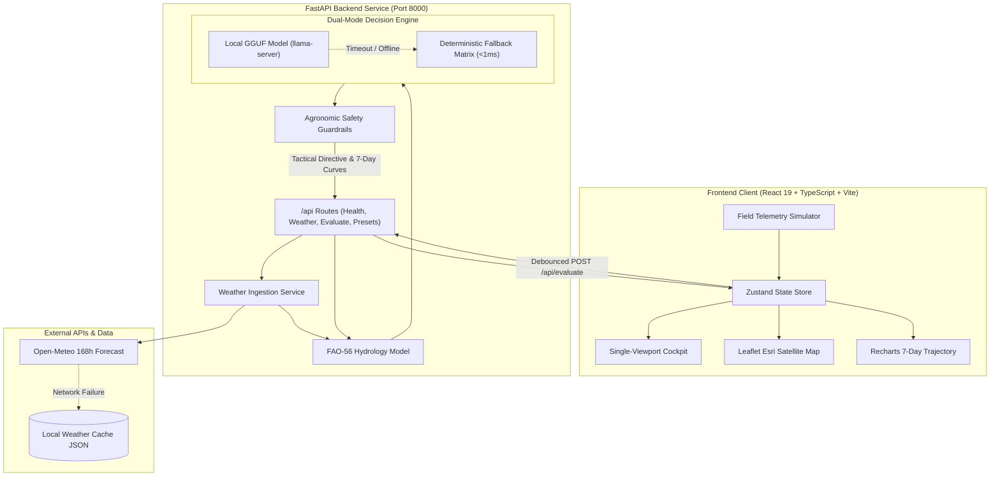

# Agri-Pulse

> **Edge-First Tactical Precision Irrigation & Micro-Climate Decision Engine for Extreme Heatwave Resilience**

[](https://www.python.org/)
[](https://fastapi.tiangolo.com/)
[](https://react.dev/)
[](https://www.typescriptlang.org/)
[](https://vitejs.dev/)
[](https://tailwindcss.com/)
[](backend/tests/)
[](Docs/API_SPECIFICATION.md)

---

## Table of Contents

- [Overview & Agronomic Motivation](#overview--agronomic-motivation)
- [System Architecture](#system-architecture)
- [Key Features](#key-features)
- [Golden Demo Scenarios](#golden-demo-scenarios)
- [Repository Structure](#repository-structure)
- [Quick Start Guide](#quick-start-guide)
  - [Prerequisites](#prerequisites)
  - [Backend Setup](#1-backend-setup-fastapi)
  - [Frontend Setup](#2-frontend-setup-react--vite)
- [Testing & Quality Assurance](#testing--quality-assurance)
- [Documentation Index](#documentation-index)
- [License](#license)

---

## Overview & Agronomic Motivation

In arid and semi-arid agricultural belts (such as the Indus Basin and South Asian agricultural zones), sudden thermal spikes exceeding 40°C during sensitive phenological windows (anthesis and pollination) cause catastrophic yield collapse:
- **Pollen Sterility:** When Wheat experiences temperatures above 38°C during anthesis, pollination failure occurs within hours if root-zone moisture cannot support transpirational cooling.
- **Hypoxic Root Rot:** Traditional flood irrigation applied in heavy clay soils creates anoxia (oxygen starvation), suffocating root hairs.
- **Midday Scalding:** Applying water under blazing noon heat can superheat the soil boundary layer, scalding root necks and causing flower drop in sensitive crops like Tomato.

**Agri-Pulse** solves this challenge by pairing physics-based hydrology with an ultra-low-latency local AI decision engine. Instead of reactive watering after wilt symptoms appear, Agri-Pulse executes **preemptive night pre-charging**, staged cycling, and hypoxia prevention before the heatwave peak hits.

---

## System Architecture



---

## Key Features

- **Photorealistic GIS Field Inspector:** Interactive 0.5m satellite imagery (Esri World Imagery) with plot boundary management, active draggable field pins, and area calculations in farmer-friendly units (Acres, Kanals, and Maunds forecast).
- **Dual-Axis 7-Day Stress Trajectory:** High-resolution synchronized visualization of temperature curves against baseline unmitigated depletion versus mitigated safe moisture levels, complete with permanent wilting point markers.
- **Sub-150ms Local AI Evaluation:** Single-pass logit scoring over candidate agronomic tokens (`PREEMPTIVE_NIGHT_PRECHARGE`, `HOLD_CURRENT_LEVEL`, `SPLIT_CYCLE_LIGHT_IRRIGATION`, `EMERGENCY_CANOPY_COOLING`).
- **Deterministic Sub-Millisecond Fallback:** Instantaneous matrix lookup that guarantees uninterrupted operation even when offline or during inference timeouts.
- **Rigid Agronomic Guardrails:** Programmatic verification ensuring zero water depth on HOLD, nocturnal execution windows for pre-charge directives, and hypoxia prevention caps for heavy soils.
- **Offline & Intermittent Connectivity Resilience:** Built-in disk caching for meteorological vectors and client-side fallback evaluations.

---

## Golden Demo Scenarios

Agri-Pulse includes three pre-configured Golden Demo scenarios accessible via the top navigation bar:

| Scenario | Crop & Phenology | Soil Texture | Environmental Hazard | Dispatched Action | Agronomic Objective |
|---|---|---|---|---|---|
| **Preset A: Heat Crisis** | Wheat (*Anthesis / Flowering*) | Sandy Loam | +6°C Heat Spike (41.5°C peak) | `PREEMPTIVE_NIGHT_PRECHARGE`<br>(24.0 mm depth, 22:00 - 04:30 PKT) | Pre-charges root zone during cool night hours to prevent pollen sterility without evaporative waste. |
| **Preset B: False Security** | Cotton (*Vegetative Growth*) | Clay | High moisture (33%), normal summer heat | `HOLD_CURRENT_LEVEL`<br>(0.0 mm depth) | Prevents farmer over-irrigation that would trigger oxygen starvation and hypoxic root rot in clay. |
| **Preset C: Imminent Scald** | Tomato (*Fruit Set*) | Loam | Extreme heat (42.0°C), low moisture (13%) | `SPLIT_CYCLE_LIGHT_IRRIGATION`<br>(12.0 mm depth, split hours) | Prevents hot-water root boiling and fruit scald through staggered light cooling applications. |

---

## Repository Structure

```
Agri-Pulse/
├── Docs/                          # Specifications, SRS, and role test plans
│   ├── AI_Decision_Engine_Spec.md # Hydrology equations and inference prompts
│   ├── API_SPECIFICATION.md       # REST endpoint schemas and error codes
│   ├── UI_REQUIREMENTS_SPEC.md    # Interface layout and accessibility rules
│   ├── person_1_frontend/         # Frontend verification plan (FE-01 - FE-06)
│   ├── person_2_backend/          # Backend verification plan (BE-01 - BE-06)
│   ├── person_3_ai_engine/        # AI engine verification plan (AI-01 - AI-05)
│   ├── person_4_integration_pitch/# Integration and pitch verification plan
│   └── README.md                  # Documentation index and navigation
│
├── backend/                       # FastAPI application & decision pipeline
│   ├── app/
│   │   ├── api/                   # REST routes & Pydantic request/response schemas
│   │   ├── fixtures/              # Bundled offline weather cache
│   │   ├── services/              # Hydrology, AI engine, guardrails, weather
│   │   ├── config.py              # Environment configuration (AGRI_ prefix)
│   │   ├── main.py                # FastAPI entry point & CORS configuration
│   │   ├── mock_service.py        # Static mock fallbacks for testing
│   │   └── presets.py             # Golden scenario preset definitions
│   ├── tests/                     # 43 automated unit & integration tests
│   ├── requirements.txt           # Production Python dependencies
│   ├── requirements-dev.txt       # Development & testing dependencies
│   ├── run.py                     # Development server runner (port 8000)
│   └── README.md                  # Backend service documentation
│
├── frontend/                      # React 19 + TypeScript + Vite dashboard
│   ├── src/
│   │   ├── components/            # Map, controls, timeline, layout, dispatch
│   │   ├── lib/                   # API client, offline mocks, and utility helpers
│   │   ├── store/                 # Zustand state store (useFieldStore)
│   │   ├── App.tsx                # Single-viewport tabbed layout
│   │   └── index.css              # Tailwind styling and custom scrollbars
│   ├── package.json               # Frontend dependencies & build scripts
│   ├── vite.config.ts             # Vite configuration
│   └── README.md                  # Frontend dashboard documentation
│
└── contracts/                     # Shared interface contracts
    ├── decision_types.ts          # TypeScript type definitions matching backend
    ├── mock_decision_response.json# Sample decision output payload
    ├── mock_weather_hydrology.json# Sample weather and hydrology payload
    └── README.md                  # Data contracts documentation
```

---

## Quick Start Guide

### Prerequisites
- **Python:** 3.11 or newer
- **Node.js:** 18.x or newer
- **npm:** 9.x or newer
- **Git**

---

### 1. Backend Setup (FastAPI)

In a PowerShell terminal:

```powershell
# Navigate to backend directory
cd backend

# Create and activate virtual environment
python -m venv .venv
.\.venv\Scripts\Activate.ps1

# Install dependencies
pip install -r requirements-dev.txt

# Start backend server
python run.py
```

The backend server will run on **`http://localhost:8000`**.
- Interactive Swagger UI: `http://localhost:8000/docs`
- Health check: `http://localhost:8000/api/health`

---

### 2. Frontend Setup (React + Vite)

In a separate terminal:

```powershell
# Navigate to frontend directory
cd frontend

# Install npm dependencies
npm install

# Start Vite development server
npm run dev
```

The web dashboard will open on **`http://localhost:5173`**.

---

## Testing & Quality Assurance

### Run Backend Test Suite
The backend contains 43 automated unit tests verifying Pydantic schema validation, endpoint contracts, decision engine inference, safety guardrails, and weather parsing:

```powershell
python -m pytest backend/tests -v
```

Expected result:
```text
============================= 43 passed in 9.27s ==============================
```

### Run Frontend Build & Typecheck
Verify TypeScript types and produce the production Vite bundle:

```powershell
cd frontend
npm run build
```

Expected result:
```text
✓ built in ~900ms
```

---

## Documentation Index

For deep-dive documentation on specific subsystems, consult the following guides:

- **[Backend Architecture & Endpoints](backend/README.md)**: Details on API endpoints, FAO-56 math, guardrail rules, and configuration settings.
- **[Frontend Architecture & Components](frontend/README.md)**: Single-viewport design principles, Zustand store, Leaflet GIS map, and Recharts trajectory graphs.
- **[Data Contracts & Type Definitions](contracts/README.md)**: Pydantic to TypeScript type mappings and sample payload structures.
- **[System Specifications & Test Plans](Docs/README.md)**: Complete index of engineering specifications and role-based test matrices.

---

## License

This project was built for agricultural resilience research and hackathon demonstrations. All rights reserved.
